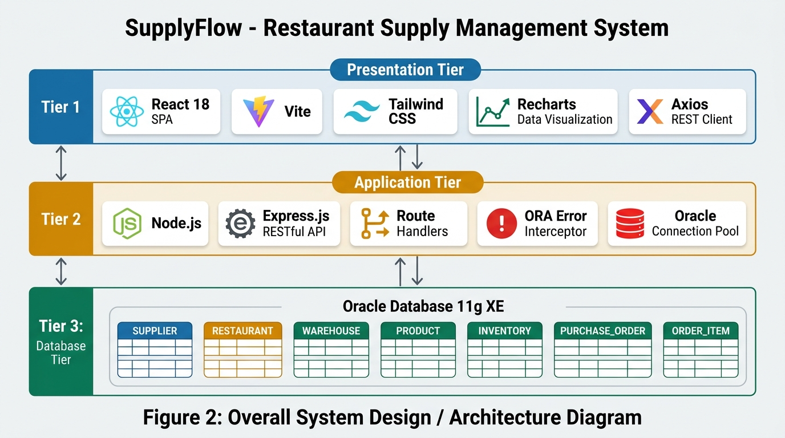
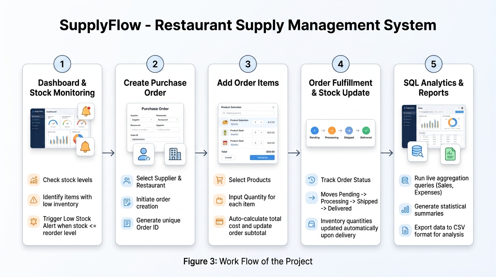

# SupplyFlow — Restaurant Supply Management System

A full-stack enterprise supply chain and inventory management system with role-based authentication, separate **Supplier** and **Restaurant** portals, distinct analytical dashboards, and administrative supply chain control. Built with **React 19**, **Vite**, **Tailwind CSS**, **Node.js / Express**, **JWT Auth**, and an **Oracle Database (SQL\*Plus / Thick mode compatible)**.

---

## 📑 Table of Contents

- [Overview](#overview)
- [Key Features](#key-features)
  - [Role-Based Portals & Dashboards](#role-based-portals--dashboards)
  - [Secure Authentication & Authorization](#secure-authentication--authorization)
- [Architecture & Workflow](#architecture--workflow)
- [Tech Stack](#tech-stack)
- [Database Schema (Oracle)](#database-schema-oracle)
- [Step-by-Step Setup Guide](#step-by-step-setup-guide)
  - [1. Database Configuration (Oracle)](#1-database-configuration-oracle)
  - [2. Backend Configuration & Startup](#2-backend-configuration--startup)
  - [3. Frontend Configuration & Startup](#3-frontend-configuration--startup)
- [Account Roles & Portals](#account-roles--portals)
- [API Endpoints Overview](#api-endpoints-overview)
- [Troubleshooting & FAQs](#troubleshooting--faqs)

---

## 📌 Overview

**SupplyFlow** streamlines operations across restaurants, suppliers, and regional warehouses with strict data isolation and dedicated workflows:
- **Supplier Portal**: Dedicated workspace for vendors to monitor product demand, track warehouse inventory, manage incoming purchase orders with status transitions (Pending → Processing → Shipped → Completed), and edit vendor business details.
- **Restaurant Portal**: Dedicated workspace for restaurant managers to browse supplier catalogs, place multi-item purchase orders with live cost calculations, cancel pending orders, track stock levels, and update restaurant profile details.
- **Administrator Console (`/admin/*`)**: Complete system-wide operations portal supporting Supplier Management, Restaurant Management, Product Catalog Control, Warehouse Hubs, Inventory Tracking with Low-Stock indicators, Order Oversight with status overrides, User Account Activation & Password Resets, and Database Analytics.
- **Unified Authentication**: Single secure login screen with role selection (Supplier, Restaurant, Admin), bcrypt password hashing, and signed JSON Web Tokens (JWT). Admin registration is strictly protected and provisioning is handled via secure CLI.

---

## ✨ Key Features

### Role-Based Portals & Dashboards

| Feature | 🏭 Supplier Portal | 🍽️ Restaurant Portal | 🛡️ Administrator Console |
|---|---|---|---|
| **Theme / Accent** | Royal Blue theme | Emerald / Teal theme | Violet / Purple theme |
| **Routes** | `/supplier/*` | `/restaurant/*` | `/admin/*` |
| **Primary Dashboard** | Product count, order status breakdown pie chart, top products by inventory bar chart, recent incoming orders | Order KPIs, total spend, recent order activity, low-stock alerts, orders breakdown | 8 overview metric cards, orders pie chart, warehouse stock bar chart, recent orders table |
| **Orders View** | Scoped to authenticated supplier; filter by status; expand item details; update order status (`Pending`, `Processing`, `Shipped`, `Completed`, `Cancelled`) | Scoped to authenticated restaurant; filter by status; expand item details; cancel pending orders | System-wide order audit; filter by restaurant, supplier, and status; status override |
| **Order Placement** | Read incoming orders | Place new purchase orders with interactive product selector, quantities, and live price estimation | N/A |
| **Inventory / Catalog** | Warehouse stock distribution for owned products; low stock alert badges | Supplier catalog browsing with unit pricing; inventory stock status overview | Global inventory across all warehouses; add & adjust stock; low-stock filtering |
| **User Management** | Profile editing | Profile editing | Full user account audit; activate/deactivate accounts; secure password reset; self-deactivation protection |
| **Reports** | Order breakdown | Spend breakdown | Monthly procurement spend trend; warehouse category stock; supplier fulfillment rankings |

### Secure Authentication & Authorization

- **`LOGIN` Table**: Strict Oracle relational schema with unique email constraint, role check constraint (`ADMIN`, `SUPPLIER`, or `RESTAURANT`), and constraint rules ensuring `ADMIN` accounts have no foreign key dependencies while `SUPPLIER` and `RESTAURANT` accounts strictly reference their corresponding business records.
- **Password Security**: Passwords hashed using `bcryptjs` with salt factor 12 before persistence.
- **JWT Tokens**: 8-hour signed session tokens carrying user identity, role, and corresponding business IDs.
- **Axios Interceptor**: Automatically attaches `Bearer <token>` to all HTTP requests and redirects on 401 token expiration.
- **React Route Guards**: `<ProtectedRoute role="ADMIN">`, `<ProtectedRoute role="SUPPLIER">`, and `<ProtectedRoute role="RESTAURANT">` prevent unauthorized portal access.
- **Audit Logging**: Significant administrative actions (status toggles, order status changes, password resets) are logged without exposing secrets.

---

## 🏛 Architecture & Workflow

The system is decoupled into an Express REST API backend and a Vite-powered React client interacting with an Oracle Database instance.

### System Architecture


### Operational Workflow


---

## 💻 Tech Stack

- **Frontend**:
  - React 19 + Vite
  - Tailwind CSS + Lucide Icons
  - Recharts (Analytics and data visualization)
  - Axios + React Router DOM
  - React Toastify
- **Backend**:
  - Node.js & Express 5
  - `oracledb` (Oracle Database driver with Thick mode support)
  - `jsonwebtoken` (JWT authentication)
  - `bcryptjs` (Password hashing)
  - `dotenv` & `cors`
- **Database**:
  - Oracle Database 11g / 19c / 21c / XE (via SQL\*Plus)

---

## 🗄 Database Schema (Oracle)

The database consists of 8 relational tables:

```text
               ┌───────────────┐
               │     LOGIN     │
               └───────┬───────┘
           ┌───────────┴───────────┐
     (role='SUPPLIER')       (role='RESTAURANT')
           │                       │
           ▼                       ▼
    ┌──────────────┐        ┌──────────────┐
    │   SUPPLIER   │        │  RESTAURANT  │
    └──────┬───────┘        └──────┬───────┘
           │ 1                     │ 1
           │                       │
           │ N                     │ N
           ▼                       ▼
    ┌──────────────┐        ┌────────────────┐
    │   PRODUCT    │        │ PURCHASE_ORDER │
    └──────┬───────┘        └───────┬────────┘
           │ 1                      │ 1
           │                        │
           │ N                      │ N
           ▼                        ▼
    ┌──────────────┐        ┌────────────────┐
    │  INVENTORY   │        │   ORDER_ITEM   │
    └──────┬───────┘        └────────────────┘
           │ N
           │
           │ 1
    ┌──────▼───────┐
    │  WAREHOUSE   │
    └──────────────┘
```

1. **`SUPPLIER`**: `supplier_id` (PK), `supplier_name`, `contact_no`, `city`
2. **`RESTAURANT`**: `restaurant_id` (PK), `restaurant_name`, `city`, `phone`
3. **`WAREHOUSE`**: `warehouse_id` (PK), `warehouse_name`, `city`
4. **`PRODUCT`**: `product_id` (PK), `product_name`, `category`, `unit_cost`, `supplier_id` (FK)
5. **`INVENTORY`**: `inventory_id` (PK), `product_id` (FK), `warehouse_id` (FK), `stock_qty`, `reorder_level`
6. **`PURCHASE_ORDER`**: `order_id` (PK), `order_date`, `supplier_id` (FK), `restaurant_id` (FK), `order_status`
7. **`ORDER_ITEM`**: `order_item_id` (PK), `order_id` (FK), `product_id` (FK), `quantity`, `total_cost`
8. **`LOGIN`**: `login_id` (PK), `email` (UQ), `password_hash`, `role`, `supplier_id` (FK), `restaurant_id` (FK), `created_at`, `is_active`

---

## 🚀 Step-by-Step Setup Guide

### 1. Database Configuration (Oracle)

#### A. Create the Base Schema (if not already done)
Open **SQL\*Plus** or **Oracle SQL Developer** and run:

```sql
@backend/sql/schema.sql
```

#### B. Create the `LOGIN` Table & Sequence
Run the authentication schema script:

```sql
@backend/sql/create_login_table.sql
```

#### C. Link Existing Supplier / Restaurant Records (Optional)
If you already have existing data from `seed.sql` and want to create login credentials for them:
1. Generate a hashed password using the backend helper:
   ```bash
   node backend/scripts/hashpw.js MySecretPassword123
   ```
2. Insert the login record in SQL\*Plus:
   ```sql
   -- For an existing Supplier (e.g. ID = 1):
   INSERT INTO login (login_id, email, password_hash, role, supplier_id, restaurant_id)
   VALUES (login_seq.NEXTVAL, 'supplier@supplyflow.com', '<generated_hash>', 'SUPPLIER', 1, NULL);

   -- For an existing Restaurant (e.g. ID = 1):
   INSERT INTO login (login_id, email, password_hash, role, supplier_id, restaurant_id)
   VALUES (login_seq.NEXTVAL, 'restaurant@supplyflow.com', '<generated_hash>', 'RESTAURANT', NULL, 1);

   COMMIT;
   ```
*(Alternatively, simply use the registration pages on the frontend to create fresh linked accounts automatically!)*

---

### 2. Backend Configuration & Startup

1. Open your terminal and navigate to `backend`:
   ```bash
   cd backend
   ```

2. Install dependencies:
   ```bash
   npm install
   ```

3. Ensure `.env` is configured with your Oracle connection:
   ```ini
   ORACLE_USER=system
   ORACLE_PASSWORD=your_actual_oracle_password
   ORACLE_CONNECT_STRING=localhost:1521/xe
   PORT=5000
   FRONTEND_URL=http://localhost:5173
   JWT_SECRET=supplyflow-secret-key-oracle-2026
   JWT_EXPIRES_IN=8h
   ```

4. Verify backend startup:
   ```bash
   npm run dev
   ```
   The backend API will start at: `http://localhost:5000`
   - Health check: `http://localhost:5000/api/health`
   - Oracle DB check: `http://localhost:5000/api/health/db`

---

### 3. Frontend Configuration & Startup

1. Open a **new terminal** and navigate to `frontend`:
   ```bash
   cd frontend
   ```

2. Install dependencies:
   ```bash
   npm install
   ```

3. Start the Vite development server:
   ```bash
   npm run dev
   ```

4. Open your browser at:
   ```text
   http://localhost:5173
   ```
   You will automatically be routed to `/login`.

---

## 🔑 Account Roles & Portals

### 1. Registering an Account
- **Supplier Registration**: Click **"Register as Supplier"** on the login screen (`/register/supplier`). Enter your company name, contact phone, city, email, and password. An entry is atomically inserted into both `SUPPLIER` and `LOGIN` tables.
- **Restaurant Registration**: Click **"Register as Restaurant"** on the login screen (`/register/restaurant`). Enter your restaurant name, city, phone, email, and password. An entry is atomically inserted into both `RESTAURANT` and `LOGIN` tables.
- **Administrator Setup**: Administrative registration is strictly protected. Administrators are provisioned via CLI:
  ```bash
  node backend/scripts/create_admin.js admin@supplyflow.com StrongPass123!
  ```

### 2. Administrator Portal Navigation (`/admin/*`)
- **Overview Dashboard** (`/admin/dashboard`): 8 overview KPI metric cards, orders status breakdown pie chart, warehouse stock bar chart, and recent purchase orders table.
- **Suppliers** (`/admin/suppliers`): Complete vendor management, search & filtering, add/edit modals, and account active/disabled toggling.
- **Restaurants** (`/admin/restaurants`): Restaurant branch directory, spending totals, add/edit modals, and account active/disabled toggling.
- **Products** (`/admin/products`): Catalog oversight, supplier associations, unit cost adjustments, and duplicate prevention.
- **Warehouses** (`/admin/warehouses`): Regional distribution hubs, stored unit metrics, and facility management.
- **Inventory** (`/admin/inventory`): System-wide stock tracking, low-stock threshold indicators (`stock_qty <= reorder_level`), and stock adjustment controls.
- **Purchase Orders** (`/admin/orders`): Global purchase order oversight, filterable by restaurant, supplier, and status, with order item inspection and status override authority.
- **User Accounts** (`/admin/users`): Security and credentials management. View all system logins, activate/deactivate accounts (with protection preventing self-lockout), and reset user passwords safely without hash exposure.
- **Reports & Stats** (`/admin/reports`): Live Oracle database business intelligence, monthly spend trends, category inventory levels, and top suppliers by volume.

### 3. Supplier Portal Navigation (`/supplier/*`)
- **Dashboard** (`/supplier/dashboard`): 4 KPI summary cards, Order status distribution pie chart, Top products by inventory bar chart, and recent orders.
- **My Products** (`/supplier/products`): List of products supplied by this vendor, category, unit cost, and current aggregate stock across all warehouses.
- **Purchase Orders** (`/supplier/orders`): Expandable list of incoming orders. Click any order to see line items, and use the status updater buttons (`Pending`, `Processing`, `Shipped`, `Completed`, `Cancelled`) to transition orders in real time.
- **Inventory** (`/supplier/inventory`): Warehouse stock levels for supplier products with low-stock badges.
- **My Profile** (`/supplier/profile`): Edit business name, phone number, and city.

### 4. Restaurant Portal Navigation (`/restaurant/*`)
- **Dashboard** (`/restaurant/dashboard`): Order counts, total spending KPI, low-stock alert feed, and recent purchase orders.
- **Purchase Orders** (`/restaurant/orders`): View placed orders, click **"Place Purchase Order"** to launch the order modal (choose supplier, add multiple products with quantities, live total calculation), and cancel pending orders.
- **Product Catalog** (`/restaurant/products`): Visual product card grid displaying items, suppliers, categories, and unit pricing.
- **Inventory** (`/restaurant/inventory`): Stock availability across warehouses with reorder alert thresholds.
- **My Profile** (`/restaurant/profile`): Edit restaurant branch name, phone number, and city.

---

## 🔑 Demo Login Credentials

The following demo accounts are pre-configured in Oracle Database for testing:

| Role Tab | Email | Password | Linked Entity | Dashboard |
|---|---|---|---|---|
| **🛡️ Admin** | `admin@supplyflow.com` | `Admin@12345` | System Superuser | `/admin/dashboard` |
| **🏭 Supplier** | `supplier1001@supplyflow.com` | `password123` | Fresh Foods Ltd (1001) | `/supplier/dashboard` |
| **🏭 Supplier** | `supplier1002@supplyflow.com` | `password123` | KitchenPro Supplies (1002) | `/supplier/dashboard` |
| **🍽️ Restaurant** | `restaurant2001@supplyflow.com` | `password123` | Spice Garden (2001) | `/restaurant/dashboard` |
| **🍽️ Restaurant** | `restaurant2002@supplyflow.com` | `password123` | Urban Bites (2002) | `/restaurant/dashboard` |

---

## 🔌 API Endpoints Overview

### Authentication (`/api/auth`)
| Method | Endpoint | Description |
|---|---|---|
| `POST` | `/api/auth/login` | Authenticate with email, password, and role (`ADMIN`, `SUPPLIER`, or `RESTAURANT`) |
| `POST` | `/api/auth/register/supplier` | Create supplier business record and login account atomically |
| `POST` | `/api/auth/register/restaurant` | Create restaurant record and login account atomically |
| `GET` | `/api/auth/me` | Verify JWT token and return active user payload |

### Administrator Portal (`/api/admin-portal`) — *Requires `ADMIN` Token*
| Method | Endpoint | Description |
|---|---|---|
| `GET` | `/dashboard` | System-wide overview KPIs, order status charts, warehouse stock, recent orders |
| `GET`, `POST` | `/suppliers` | List all suppliers (with product/order counts) / Create supplier |
| `PUT` | `/suppliers/:id` | Update supplier details |
| `PUT` | `/suppliers/:id/toggle-status` | Activate or deactivate supplier login account |
| `GET`, `POST` | `/restaurants` | List all restaurants / Create restaurant |
| `PUT` | `/restaurants/:id` | Update restaurant details |
| `PUT` | `/restaurants/:id/toggle-status` | Activate or deactivate restaurant login account |
| `GET`, `POST` | `/products` | List all products with total stock / Add product (with duplicate prevention) |
| `PUT`, `DELETE` | `/products/:id` | Edit product details / Delete product |
| `GET`, `POST` | `/warehouses` | List warehouses with inventory statistics / Create warehouse |
| `PUT`, `DELETE` | `/warehouses/:id` | Edit warehouse details / Delete warehouse |
| `GET`, `POST` | `/inventory` | Inspect global inventory / Add inventory record |
| `PUT`, `DELETE` | `/inventory/:id` | Update stock quantity or reorder level / Delete record |
| `GET` | `/orders` | Filterable list of all purchase orders across restaurants |
| `GET` | `/orders/:id` | Order details and associated line items |
| `PUT` | `/orders/:id/status` | Update order status with valid transition validation |
| `GET` | `/users` | List all system login accounts (never exposes password hashes) |
| `PUT` | `/users/:id/toggle-status` | Activate or deactivate account (with self-deactivation guard) |
| `POST` | `/users/:id/reset-password` | Reset password for any user account safely |
| `GET` | `/reports` | Aggregate monthly spending, category stock, and supplier volume |

### Supplier Portal (`/api/supplier-portal`) — *Requires `SUPPLIER` Token*
| Method | Endpoint | Description |
|---|---|---|
| `GET` | `/dashboard` | Supplier KPIs, status charts, top products, recent orders |
| `GET`, `PUT` | `/profile` | Get vendor profile details / Update vendor name, contact, city |
| `GET` | `/products` | List products supplied by authenticated vendor with total stock |
| `GET` | `/orders` | List purchase orders placed with this supplier |
| `GET` | `/orders/:orderId` | Get specific purchase order and line items |
| `PUT` | `/orders/:orderId/status` | Update purchase order status (`Pending`, `Processing`, `Shipped`, `Completed`, `Cancelled`) |
| `GET` | `/inventory` | Stock levels across warehouses for supplier's products |

### Restaurant Portal (`/api/restaurant-portal`) — *Requires `RESTAURANT` Token*
| Method | Endpoint | Description |
|---|---|---|
| `GET` | `/dashboard` | Restaurant KPIs, total spend, recent orders, low stock alerts |
| `GET`, `PUT` | `/profile` | Get restaurant profile details / Update restaurant details |
| `GET` | `/suppliers` | List available suppliers for placing orders |
| `GET` | `/products` | Browse system product catalog |
| `GET` | `/inventory` | Inspect warehouse inventory and stock warning status |
| `GET` | `/orders` | List purchase orders placed by this restaurant |
| `GET` | `/orders/:orderId` | Get order details and line items |
| `POST` | `/orders` | Place new purchase order with multiple line items |
| `PUT` | `/orders/:orderId/cancel` | Cancel a pending purchase order |

---

## 🛠 Troubleshooting & FAQs

- **`ORA-01017: invalid username/password`**:
  Double-check `ORACLE_USER` and `ORACLE_PASSWORD` in `backend/.env`.
- **`ORA-12541: TNS:no listener` / `ORA-12514`**:
  Ensure the Oracle Database service and listener are running in Windows Services (`services.msc`) or run `lsnrctl status` in Command Prompt.
- **Thick Mode / Oracle Client Error (11g)**:
  The project includes `instantclient_19_26` under the `backend` directory, automatically configured for Oracle 11g compatibility in `backend/src/config/database.js`.
- **Token expired or 401 Unauthorized**:
  Tokens expire after 8 hours by default. The Axios interceptor will automatically wipe expired tokens and redirect to the `/login` page.

---

## 📄 License

This project is licensed under the ISC License.
